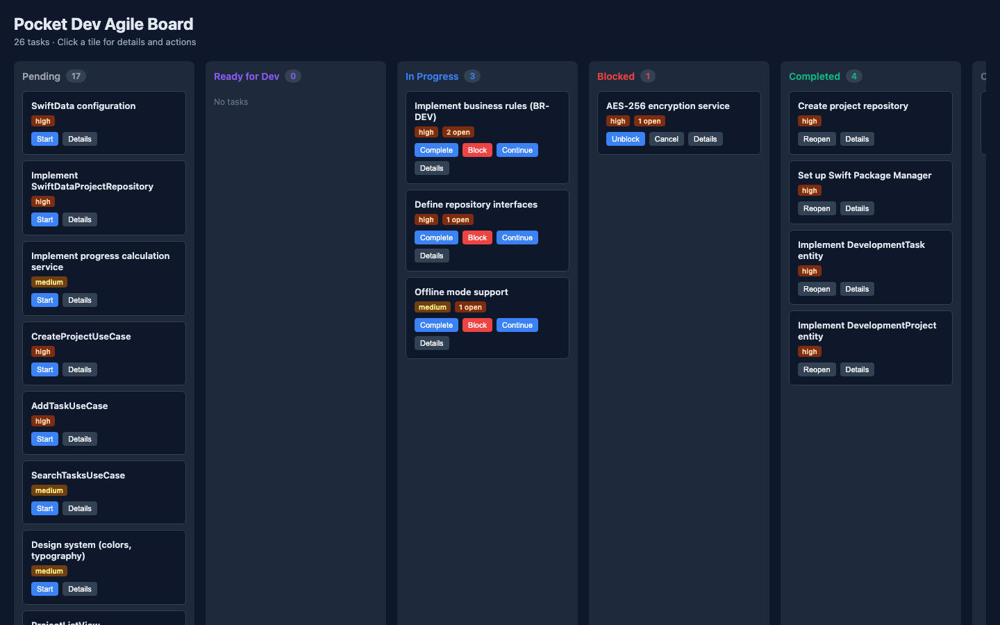
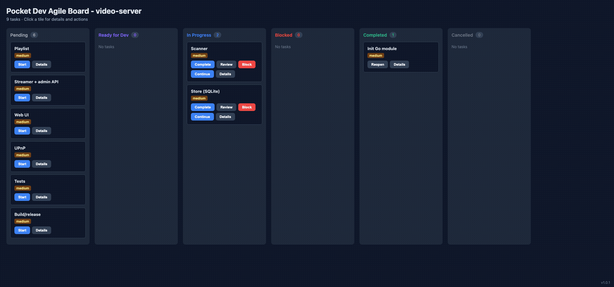

# Pocket Dev — Solo Agent Development Framework

> **Version**: 1.1.0 &nbsp;&nbsp; **Package**: `npm install -g pocket-dev` &nbsp;&nbsp; **Status**: Active

---

## ✨ One Developer + AI Agents = Full Product Development

Pocket Dev is a **complete framework and toolchain** that enables a **single developer working with AI coding agents** to **plan, design, specify, and implement** applications from idea to production-ready code — **with the rigor of a full team** and the speed of solo development.

### Why Solo Developers Need Pocket Dev

You're one person with big ideas, but:
- **Ambiguity slows you down** – AI agents need crystal-clear instructions
- **Quality is inconsistent** – You need repeatable standards without bureaucracy
- **Progress is invisible** – You lose track of what's done and what's next
- **Agents work in silos** – They need coordination, context, and validation

**Pocket Dev solves this with:**
- **Agent-ready specifications** – Every task is unambiguous and testable
- **6-phase methodology** – Ideation → Discovery → Specification → Design → Implementation → Verification
- **Quality gates** – Objective checkpoints that agents can validate automatically
- **Live Kanban board** – Real-time visibility with interactive task management (6 columns)
- **Auto-agent triggering** – Click a task action, the relevant agent starts working
- **Terminal overlay** – See agent session details directly in the browser
- **Multi-agent support** – Works with Vibe, Claude Code, and OpenCode
- **Human-in-the-loop** – Critical phases require human interaction
- **State consistency** – Tasks stay in-progress until implementation is verified

---

## 🚀 60-Second Start

### Option A: Install from this repository (Development)

```bash
# Clone the repository
git clone <repo-url> pocket-dev
cd pocket-dev

# Build the CLI
npm run build

# Run directly (no installation needed)
node packages/cli/dist/index.js init

# Or use the wrapper script
./pocket-dev-cli.sh init

# Launch the agile board
./pocket-dev-cli.sh board --open
```

### Option B: Install globally (After publishing to npm)

```bash
# Install globally (once published)
npm install -g pocket-dev

# Initialize your project
cd /your/project
pocket-dev init

# Launch the agile board
pocket-dev board --open
```

### Option C: Link for development

```bash
# In the pocket-dev repository
npm run build
npm link

# Now pocket-dev CLI is available globally
cd /your/project
pocket-dev init
pocket-dev board --open
```

**That's it.** The framework docs install under `.pocket-dev/`, your Kanban board opens in the browser, and every action you take triggers the appropriate AI agent with full context.

---

## 🎯 How It Works

### 1. Define Your Idea
Start with a clear problem statement. Pocket Dev provides templates for every artifact:
- **Idea documents** – What problem are you solving?
- **Research findings** – What exists? What are the constraints?
- **User stories** – Who benefits and how?

### 2. Click to Progress
Each task on the Kanban board has **action buttons** (Start, Complete, Block, Unblock). When you click:
1. ✅ **Status updates** – Task moves to the appropriate column
2. 🖥️ **Terminal overlay** – Shows agent session details and observation instructions
3. 🤖 **Agent launches** – The configured AI agent (Vibe, Claude, OpenCode) receives:
   - Full task context (name, description, phase, open items, next steps)
   - Phase-specific methodology guidelines
   - Relevant templates and standards
   - Instructions to update state when done
   - Observation instructions for monitoring progress
4. 📊 **State persists** – Everything is saved to `.pocket-dev/state.json`

### 3. Validate & Repeat
- Run `pocket-dev validate` to ensure everything meets quality gates
- The board updates in real-time
- Agents continue where they left off

---

## 📹 See It In Action



*Board with 6 columns: Pending, Ready for Dev, In Progress, Blocked, Completed, Cancelled · Click a tile → View details, open items, and next steps → Click action button → Agent begins work with full context from the framework*


*Click a task tile → Drawer opens with details → Click action button → Terminal overlay shows session → Agent triggered automatically*

> **Note**: Screenshots will be updated to reflect the latest 6-column board design and terminal overlay features.

---

## 🎛️ Commands

| Command | What it does |
|---------|--------------|
| `pocket-dev init [dir]` | Installs framework into `.pocket-dev/` with your choice of AI integration |
| `pocket-dev status` | Shows project overview: name, phase, task counts by status |
| `pocket-dev validate` | Runs 170+ consistency checks against the framework |
| `pocket-dev deps` | Verifies Node.js, npm, Git, and other required tools |
| `pocket-dev board [--port 4173] [--open]` | Serves the interactive Kanban board |
| `pocket-dev version [--bump patch|minor|major]` | Show or bump version |
| `pocket-dev update [--branch main|dev]` | Pull and install latest version |
| `pocket-dev scan [-v]` | Scans specs directory and populates state.json with features and tasks |
| `pocket-dev map <name> [-d dest]` | Chart a Wayfinder-style decision map (plan, don't do) |
| `pocket-dev grill [topic]` | Lazy CONTEXT.md + ADR scaffolding (grill-with-docs style) |
| `pocket-dev runtime [--reconfigure]` | Detect/configure execution runtimes (herdr, tmux) |
### Board Actions

When viewing the board, each task card has action buttons:

| Button | From Status | To Status | Trigger |
|--------|-------------|-----------|---------|
| **Start** | Pending | In Progress | Auto-agent triggered |
| **Start Dev** | Ready for Dev | In Progress | Auto-agent triggered |
| **Continue** | In Progress | In Progress | Auto-agent triggered |
| **Complete** | In Progress | Completed | Auto-agent triggered |
| **Block** | In Progress | Blocked | Auto-agent triggered |
| **Unblock** | Blocked | In Progress | Auto-agent triggered |
| **Reopen** | Completed/Cancelled | In Progress | Auto-agent triggered |

Each action triggers the configured AI agent (Vibe, Claude, OpenCode) with full task context.

---

## 🏗️ Project Structure

```
Your Project/
├── AGENTS.md                            # Project-specific agent instructions (OPTIONAL)
│                                       #   Override default framework behavior
│                                       #   Require human interaction for specific phases
│   
├── .pocket-dev/                          # Framework installation
│   ├── 00-constitution/                 # Core principles & rules
│   ├── 01-governance/                   # Decision processes
│   ├── 02-methodology/                  # 6 phases, 6 gates
│   ├── 03-standards/                    # Language & UI conventions
│   ├── 04-templates/                    # Spec, design, test templates
│   ├── 05-checklists/                   # Gate validation criteria
│   ├── 06-automation/                   # Agent instructions & scripts
│   ├── 07-examples/                     # Example implementations
│   ├── state.json                       # Project state & tasks
│   ├── GETTING-STARTED.md               # Quick start guide
│   └── prompt-*.md                      # Agent context files
├── specs/                               # Your feature specifications
│   └── [feature-id]/                    # Per-feature artifacts
└── [your code]                          # Your implementation
```

**AGENTS.md Location**: Place `AGENTS.md` in your **project root** (same level as `.pocket-dev/`) to provide project-specific agent instructions that override the default framework behavior.

---

## 🤖 AI Agent Integration

Pocket Dev works with your preferred AI coding assistant:

| Integration | Setup | How it Works |
|-------------|-------|--------------|
| **Mistral Vibe** | `pocket-dev init --integration vibe` | Click actions → `vibe -p "..."` runs with full context |
| **Claude Code** | `pocket-dev init --integration claude` | Click actions → Agent prompt saved, paste into Claude |
| **OpenCode** | `pocket-dev init --integration opencode` | Click actions → TUI opens, run `/pocket-dev` |

*All integrations include the same framework, templates, and validation – only the agent trigger method differs.*

---

## 📋 Methodology Overview

### 6 Phases (Every Feature Must Pass Through)

| Phase | Goal | Key Questions | Quality Gate |
|-------|------|---------------|--------------|
| **0. Ideation** | Validate the idea | What problem does this solve? Who is it for? | Gate 0: Idea Approved |
| **1. Discovery** | Gather all information | What do we need to know to specify this? | Gate 1: Discovery Complete |
| **2. Specification** | Define WHAT to build | What exactly are we building? How will we know it's correct? | Gate 2: Specification Approved |
| **3. Design** | Define HOW to build | What architecture supports the requirements? | Gate 3: Design Approved |
| **4. Implementation** | Build the feature | Is the code complete, tested, and documented? | Gate 4: Implementation Complete |
| **5. Verification** | Ensure quality | Does it meet all acceptance criteria? | Gate 5: Verification Passed |

### Quality Gates
Each gate has **mandatory checklists** that must pass before proceeding. No exceptions. This ensures:
- Zero ambiguity for agents
- Consistent quality across features
- Catching issues early

Run `pocket-dev validate` anytime to check against all gates.

---

## 🏆 Success Metrics

Pocket Dev is successful when:

✅ **A solo developer + agents** can complete a feature with **zero manual clarification**

✅ **All artifacts** meet defined quality criteria without human review

✅ **The process is repeatable** – same quality, every time

✅ **Quality gates catch issues** before they reach production

✅ **Time from idea to production** is predictable and minimized

---

## 📚 Key Documents

| Purpose | Location |
|---------|----------|
| **Get started** | `GETTING-STARTED.md` |
| **Full overview** | `SUMMARY.md` |
| **CLI & board guide** | `docs/POCKET-DEV.md` |
| **Core principles** | `.pocket-dev/00-constitution/constitution.md` |
| **Process details** | `.pocket-dev/02-methodology/process-overview.md` |
| **Templates** | `.pocket-dev/04-templates/` |
| **Checklists** | `.pocket-dev/05-checklists/` |
| **Example feature** | `07-examples/pocket-dev-module/` |

---

## 🎯 Next Steps

1. **Install**: `npm install -g pocket-dev`
2. **Initialize**: `pocket-dev init`
3. **Explore**: Read `.pocket-dev/GETTING-STARTED.md`
4. **Validate**: `pocket-dev validate`
5. **Develop**: `pocket-dev board --open`

---

> **"Pocket Dev turns solo development from chaos to clarity, and from solitary work to a well-orchestrated partnership with AI."**

---

**Framework**: v1.1.0 &nbsp;&nbsp; **Package**: `pocket-dev` &nbsp;&nbsp; **License**: MIT &nbsp;&nbsp; **Repository**: [github.com/r4nd0mn3rd/pocket-dev](https://github.com/r4nd0mn3rd/pocket-dev)
