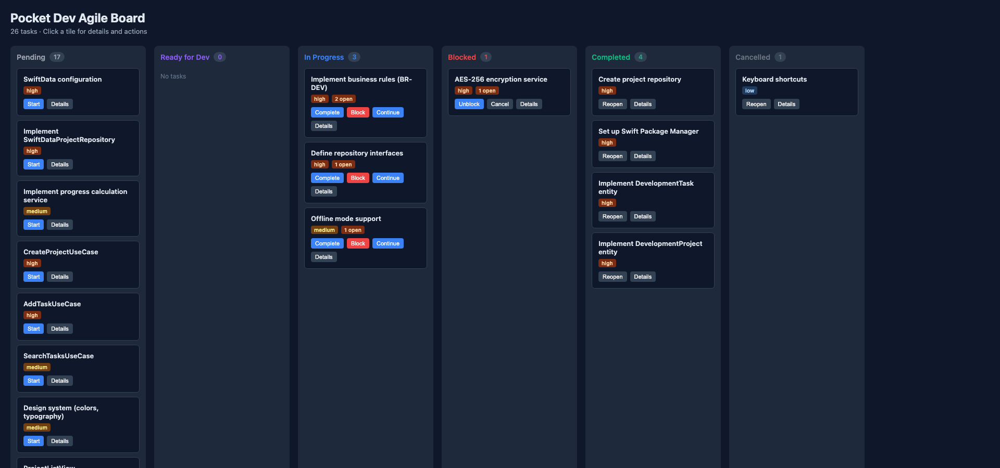

# Pocket Dev CLI & Kanban Board

Pocket Dev is the command-line interface and web board that operationalizes the Solo Agent Development Framework.

## Installation

```bash
npm install -g pocket-dev
# or, from a checkout:
npm install
npm run build
```

## Commands

### `pocket-dev init`

Interactively (or via flag) sets up framework integration for Claude, OpenCode, or Vibe.

```bash
pocket-dev init                 # prompts for integration choice
pocket-dev init --integration claude
pocket-dev init --integration opencode
pocket-dev init --integration vibe
```

Generates agent-specific files under `.pocket-dev/` and prints usage instructions.

### `pocket-dev status`

Shows project name, current phase, and task counts by status.

### `pocket-dev validate`

Runs the framework consistency check (170+ checks).

### `pocket-dev deps`

Checks build/test availability (node, npm, git, etc.).

### `pocket-dev board`

Serves the interactive Kanban board.

```bash
pocket-dev board               # http://localhost:4173
pocket-dev board --port 4177
pocket-dev board --open
```

Tasks are read from `.pocket-dev/state.json`. The board displays columns for: Pending, Ready for Dev, In Progress, Blocked, Completed, Cancelled.

### `pocket-dev scan`

Scans the `specs/` directory and populates `state.json` with features and tasks.

```bash
pocket-dev scan
pocket-dev scan -v             # verbose
```

## Kanban Board



The board groups task tiles by status. Clicking a tile opens a drawer with open items, next steps, blocked reason, and action buttons.

### Columns

1. **Pending** - New tasks not yet started
2. **Ready for Dev** - Fully specified tasks waiting for implementation
3. **In Progress** - Tasks being actively worked on
4. **Blocked** - Tasks blocked by external factors
5. **Completed** - Tasks that are done
6. **Cancelled** - Cancelled tasks

### Action Buttons

Each task card shows action buttons based on status:

| Status | Actions Available |
|--------|------------------|
| Pending | Start |
| Ready for Dev | Start Dev |
| In Progress | Complete, Continue, Block |
| Blocked | Unblock, Cancel |
| Completed | Reopen |
| Cancelled | Reopen |

### Terminal Overlay

When you trigger an agent action, a terminal overlay appears showing:
- Agent session start time
- Action type
- Task name and phase
- Status
- Integration type
- Instructions on how to observe the running task

## Task lifecycle transitions

- `pending` → `in-progress` (Start)
- `ready-for-dev` → `in-progress` (Start Dev)
- `in-progress` → `completed` (Complete) / `blocked` / `in-progress` (Continue)
- `blocked` → `in-progress` (Unblock)
- `completed`/`cancelled` → `in-progress` (Reopen)

## Agent Integration

The board auto-triggers AI agents when actions are clicked:

| Agent | Method | Observation |
|-------|--------|-------------|
| Vibe | `vibe -p "<prompt>"` | Check Vibe terminal |
| Claude | `claude --prompt "<prompt>"` | Check Claude terminal |
| OpenCode | `opencode --prompt "<prompt>" <path>` | Check OpenCode application |
| None | Prompt saved to file | Manual review required |

## Agent Trigger Behavior

- **Phases 0-2** (Ideation, Discovery, Specification): Require human interaction, agent not auto-triggered
- **Phases 3-5** (Design, Implementation, Verification): Auto-trigger agent on action
- **Terminal Overlay**: Shows agent details and observation instructions
- **Prompt Files**: Saved to `.pocket-dev/prompt-{task-id}-{timestamp}.md`